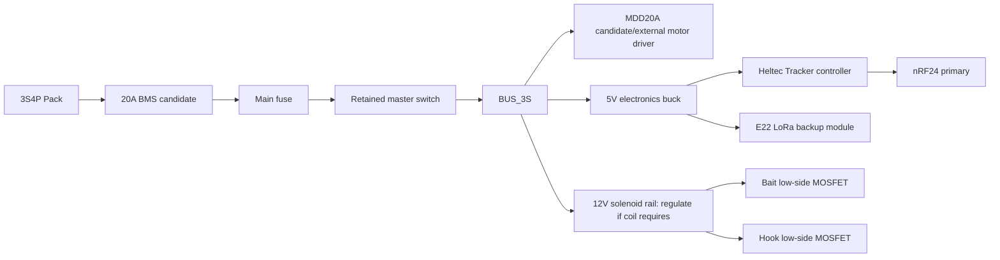
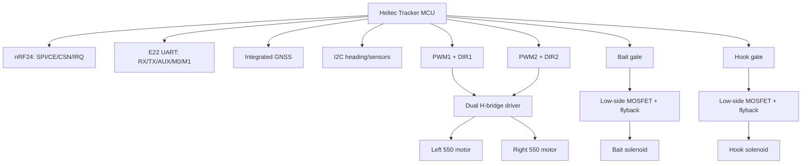

# Boat Hardware Block and Wiring Diagrams R1

## Power tree

Current limits, branch fuses, converter sizing, coil voltage and motor stall current are not finalized.

## Control and outputs

The controller pin numbers are not frozen; use the exact Tracker schematic. Motor driver module is larger than the measured 77×79mm carrier area and requires separate placement or a mechanical revision.
