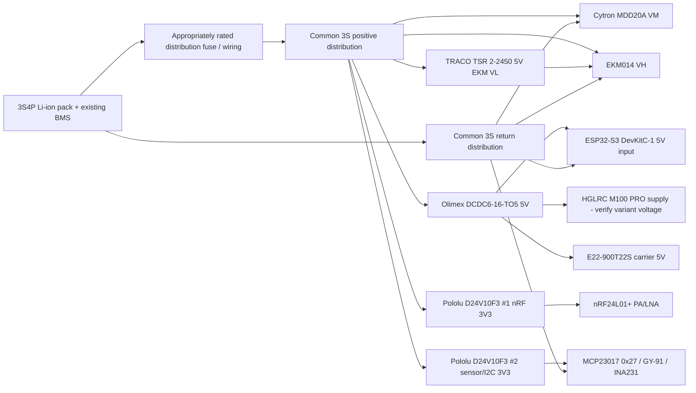
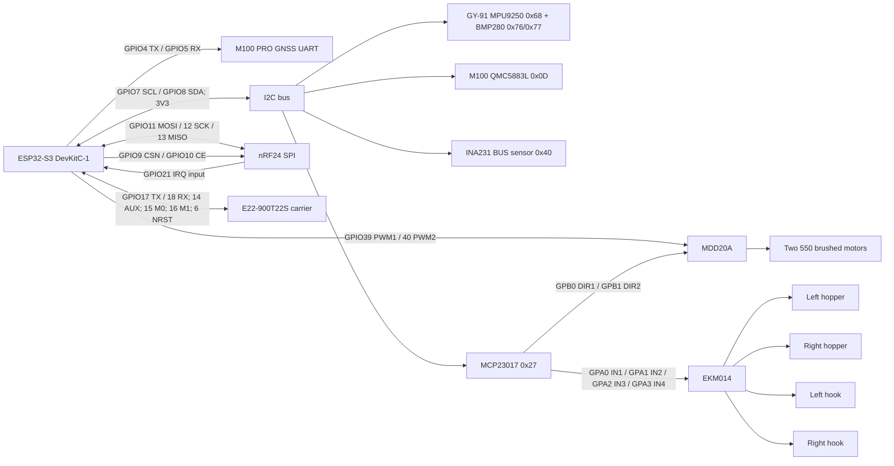

# R30H-31 Boat — electrical wiring schematic and pin assignment
**2026-11-23 | Active VS Code/PlatformIO branch | DESIGN / NOT ASSEMBLED**

This document supersedes historical independent safety contactor and limiter drawings. **No dedicated hardware failsafe circuitry.** Software STOP, dual-radio-loss conditional RTH, low-battery response, ESP32 internal watchdog, 100 ms actuator command lease, and one-solenoid-at-a-time timing remain. **A software STOP does not prove load current zero.** Normal fusing, BMS, wire sizing and regulator protection remain standard power wiring, not dedicated failsafe controllers.

## Power schematic

No separate motor/coil battery or independent power-cut relay. Do not connect regulator outputs in parallel. EKM014 VL is regulated 5V and VH is common 3S. INA231 is BUS-voltage sensing only; **never** put its 0.1-ohm shunt in the motor/coil feed. MDD20A terminal naming and M100 supply tolerance require module-label confirmation. Avoid USB-5V/external-5V backfeed.

## Control schematic

## Complete assigned signal pins
| Endpoint | Source | Destination |
|---|---|---|
| GNSS UART | ESP GPIO4 TX / GPIO5 RX | M100 RX / TX, crossed |
| I2C | ESP GPIO7 SCL / GPIO8 SDA | QMC5883L 0x0D; GY-91 MPU9250 0x68; BMP280 0x76/0x77; INA231 0x40; MCP23017 0x27 |
| nRF SPI | GPIO11 MOSI, 12 SCK, 13 MISO | nRF MOSI, SCK, MISO |
| nRF control | GPIO9 CSN, 10 CE, 21 IRQ | nRF CSN, CE, IRQ |
| E22 | GPIO17 TX, 18 RX, 15 M0, 16 M1, 14 AUX, 6 NRST | E22 RXD, TXD, M0, M1, AUX, NRST |
| Motor PWM | GPIO39, GPIO40 | MDD20A PWM1, PWM2 |
| Motor direction | MCP23017 0x27 GPB0, GPB1 | MDD20A DIR1, DIR2 |
| Solenoid outputs | MCP23017 0x27 GPA0..GPA3 | EKM014 IN1..IN4 (LH, RH, LK, RK) |
| Solenoid loads | EKM014 CH1..CH4 | Hopper left/right, hook left/right |
| GNSS PPS | NOT CONNECTED | M100 PPS not established; GPS time over UART |
| GPIO1,2,41,42 | UNUSED/SPARE | Previous independent safety assignments retired |
| GPIO35..38/48, 0/3/45/46, 19/20, 43/44 | BOARD-RESERVED | Memory/LED, boot, USB, UART; avoid reassignment |

**Address straps:** MCP23017 0x27 requires A2=A1=A0=HIGH (check actual module pullups). INA231 0x40 must match module straps. I2C devices require a common 3.3V logic domain and suitable pullups. E22 module 5V power is distinct from 3.3V UART logic.

**Open items, not invented:** exact MDD20A header contact numbering, EKM014 header orientation, M100 voltage variant, E22 carrier contact mapping, harness pin numbering, fuse/wire gauges, and whether GY-91 BMP280 responds at 0x76 or 0x77. These are module/connector details, **not missing ESP GPIO assignments**. No external STOP/watchdog/current-zero pins will be added.
