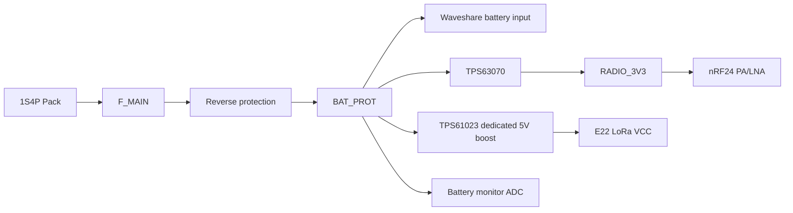
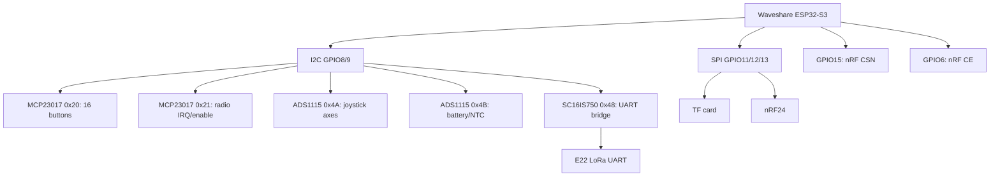

# Remote Hardware Block and Wiring Diagrams R1

## Power distribution

LoRa module accepts 2.7–5.5V; 5V guarantees output power. A dedicated TPS61023 5V branch powers E22 only, so the CS8501 controller/display rail stays within its board-load specification. This is a separate load/converter, not parallel outputs. nRF has separate 3.3V converter.

## Controller and I/O

GPIO6 repurposes Sensor AD; GPIO15 repurposes RS485 TX. RS485 bus must be disconnected/disabled. Exact header crosswalk and continuity verification still required.

## RF connectors
- LEFT: 2.4GHz nRF24 PA/LNA antenna.
- RIGHT: 868MHz LoRa antenna.
- ESP32 Wi-Fi/Bluetooth: onboard antenna.
