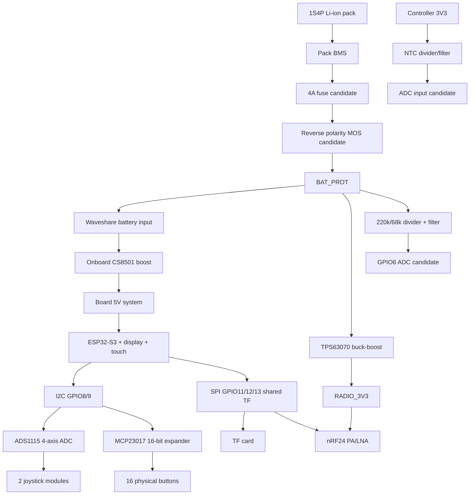

# Remote Power + Controls Block Diagram R1

This block diagram is architectural only. It is not a circuit schematic, pin-complete netlist or ERC result.

## Key constraints
- Onboard controller boost is baseline; external TPS61023 is a fallback only.
- Radio has its own buck-boost rail.
- ADS1115 and MCP23017 share the board I2C bus with onboard peripherals; addresses/pullups must be verified.
- TF card and nRF share SPI; software must arbitrate and prioritize radio.
- GPIO/connector assignments remain provisional.
