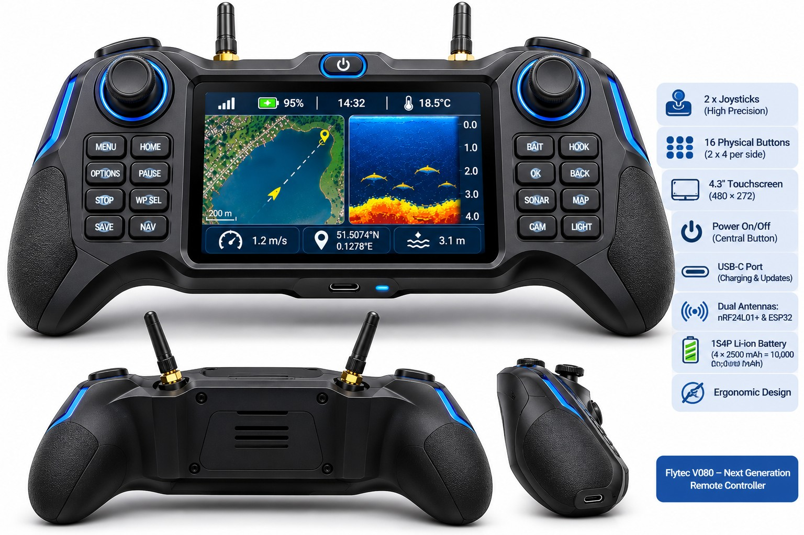

# New Handheld Remote — Preliminary Concept

**Status:** Preferred concept / preliminary design only. Not final CAD, PCB, firmware, or purchased hardware.

## Design baseline
- New ergonomic handheld controller inspired by modern game controllers.
- Central 4.3-inch landscape touchscreen for map, sonar, telemetry, and settings.
- Two analog joysticks positioned **above** the button clusters.
- **16 physical buttons total**, split equally: 8 left and 8 right.
- Each side uses a **2 columns × 4 rows (2×4)** button grid.
- Plain functional labels; no PlayStation symbols.
- No shoulder buttons and no rear buttons.
- Ergonomic lower grips.
- Two rear antenna exits, both functional and electrically independent:
  - Antenna A: nRF24L01+ PA/LNA boat-control/telemetry radio.
  - Antenna B: ESP32-S3 Wi-Fi/Bluetooth, only with a board/module variant that supports an external antenna.
- Battery concept: **1S4P Li-ion, 4 × 2500 mAh matched cells = 10,000 mAh nominal pack capacity**, USB-C charging.
- Dark graphite/black enclosure with blue accents is the preferred visual direction.

## Preliminary button assignment

### Left bank (2×4)
| Position | Function |
|---|---|
| L1 | MENU |
| L2 | HOME |
| L3 | OPTIONS |
| L4 | PAUSE |
| L5 | STOP |
| L6 | WP SELECT |
| L7 | SAVE WAYPOINT |
| L8 | NAV / navigation command |

### Right bank (2×4)
| Position | Function |
|---|---|
| R1 | BAIT |
| R2 | HOOK |
| R3 | OK / CONFIRM |
| R4 | BACK |
| R5 | SONAR |
| R6 | MAP |
| R7 | CAM (reserved; depends on camera feature) |
| R8 | LIGHT (reserved; depends on boat lighting hardware) |

Button labels and functions are preliminary and can be remapped without changing the physical 2×4 layout. Bait/hook activation must have deliberate safety confirmation/hold behavior. STOP must override propulsion commands and inhibit release actions; exact STOP latch/reset behavior will be defined in the safety specification.

## Preliminary mechanical envelope (not final)
- Width: approximately 290–320 mm
- Height: approximately 175–195 mm
- Depth: approximately 55–70 mm
- Display opening/fit, joystick centers, button spacing, grip ergonomics, antenna spacing and mounting details require CAD refinement and prototype testing.

## Dual-antenna RF note
Two antennas are intended for two separate RF systems; they are not diversity antennas for a single nRF24 radio. Both systems operate in the 2.4 GHz band, so antenna placement alone does not guarantee coexistence. RF separation, ground-plane/layout, filtering, radio scheduling/coexistence and regulatory EIRP must be evaluated. Do not connect both radios to a shared antenna.

## Power note
A 1S4P pack built from four 2500 mAh cells has 10,000 mAh nominal capacity. With 3.6–3.7 V nominal cell voltage, pack nominal energy is approximately 36–37 Wh. Actual charging, protection, fuse, cell matching, thermal design, regulator sizing, and pack assembly safety must be engineered before build. USB-C charging implementation is TBD.

## Next design phase
Create a dimensioned front/rear/side template and CAD mock-up. Validate display and joystick component footprints, button spacing and thumb reach, antenna placement and internal battery/electronics volume before selecting final parts or producing PCBs.

## New hardware-design additions
- Dedicated physical power ON/OFF button centered above the display, separate from the 16 function buttons. Electrical implementation (soft power latch vs direct switched power) remains to be selected.
- USB-C service port planned on the lower enclosure edge. It is intended for 1S pack charging and ESP32-S3 firmware/data access through one connector. This requires a validated USB-C sink/CC implementation, ESD protection, a charger with suitable power-path/load-sharing behavior, and USB data routing compatible with the selected ESP32 module. Do not assume charging and programming can safely occur simultaneously until the power-path circuit is designed and tested.
- Hardware design workspace: `Remote/New_Handheld_Remote/`. It contains an initial OpenSCAD fit template, mechanical print plan, modular PCB architecture, connector interface plan and schematic checklist. These are preliminary design files, not fabrication-ready CAD/PCB/schematics.

## Mechanical refinement R1 (2026-11-18)
- Target envelope refined to 310 × 190 × 62 mm for layout work (provisional).
- Front-panel draft coordinates: display centered at y=-3; power at y=+82; joysticks at x=±105, y=+58; button banks at x=±112, y=-30 with 21 mm pitch.
- Internal zones planned for a lower-central battery pack, central controller/display stack, radio near antenna A, separate ESP32 antenna path near antenna B, and power/charging near USB-C.
- See `Remote/New_Handheld_Remote/MECHANICAL/COMPONENT_PLACEMENT_R1.md` for the coordinate table, risks, and fit-validation workflow.
- All measurements remain provisional until real component datasheets and physical samples are checked.

## Updated visual baseline — uploaded reference (2026-11-18)
- Adopt the uploaded image's shape and front/rear/side styling as the design target: angular upper shoulders, recessed central screen/bezel, joystick wells, broad textured side grips and lower grip contours, rear service cover, two antennas, and lower centered USB-C.
- Remove all blue LED/backlight styling: no illuminated joystick rings, grip strips, glowing button borders, or decorative LEDs.
- Keep the controller matte black/dark graphite. Functional screen and normal status indicators are retained; decorative lighting is not.
- The next CAD revision must sculpt the shell silhouette and grip geometry; the existing rounded-rectangle shell is only a template and does not yet match the reference.

## Official concept image

Repository image: `Remote/New_Handheld_Remote/CONCEPT/Flytec_Remote_Concept_Reference.jpg`. Verified uploaded JPEG (344,416 bytes). Blue decorative LED/backlighting is excluded from the mechanical design baseline.

## Mechanical refinement R2 — concept preview (2026-11-18)
- Generated a multi-view concept preview to explore front, angled, rear, side, and internal layout styling against the user's uploaded reference.
- Visual target: sculpted matte-black shell, textured grips, recessed display, joystick wells, rear access panel, dual antennas, lower USB-C.
- Decorative LED rings, grip strips, illuminated button surrounds, and blue backlighting remain excluded.
- Preview is illustrative only. Dimensions and internal arrangement shown are not verified CAD or component-fit results; next CAD work must translate the contours into parametric geometry and validate physical parts.

## Mechanical refinement R2 — expanded battery reserve (2026-11-18)
- Provisional shell depth allowance increased from 62 to 70 mm to provide additional internal volume.
- Reserved lower-central battery volume enlarged to 104 × 82 × 24 mm (placeholder envelope).
- Controller/display envelope moved upward in the space study to improve separation from the battery reserve.
- Four 18650 placeholders remain illustrative; pack retention, electrical protection, charger, wiring, and clearances are not designed or validated.
- OpenSCAD internal mockup R2 was rendered to STL successfully; PNG render attempt failed due to headless OpenGL/X-server limitation. A separate schematic space preview is available for review.
- This revision is a layout study, not verified assembly or print-ready CAD.

## Component integration basis
- 1S4P four-cell 18650 pack (target 10 Ah) is the battery architecture.
- Display/controller candidate is Waveshare ESP32-S3-Touch-LCD-4.3; onboard antenna is a known mismatch with the external ESP32 antenna requirement.
- Preferred compact joystick candidate: C&K THB001P.
- Charger/power-path candidate: TI BQ25895; 2 A initial charge-current target subject to cell/pack/thermal validation.
- Detailed dimensions and unresolved selection items are recorded in the component integration plan.
