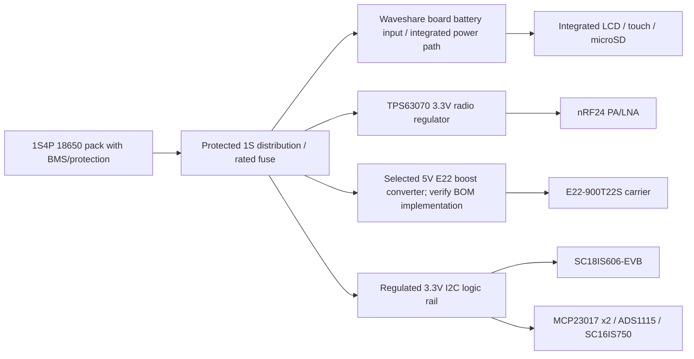
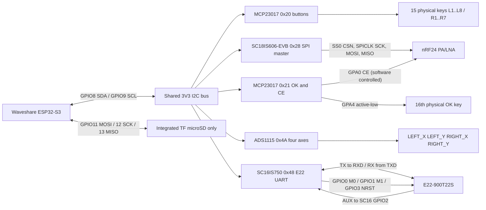

# R30H-31 Remote — electrical wiring schematic and pin assignment
**2026-11-23 | Waveshare ESP32-S3-Touch-LCD-4.3 Standard | DESIGN / NOT ASSEMBLED**

Uses one existing Waveshare display/touch/TF controller, **two MCP23017 I2C expanders**, SC18IS606-EVB isolated nRF SPI, SC16IS750 E22 UART, ADS1115 joystick ADC. No additional ESP32, custom PCB, or dedicated hardware failsafe module.

## Power schematic

Do not tie regulator outputs together. Validate the Waveshare board's charging/power-path connector against the exact Standard revision before applying pack power. The 1S4P cells are in parallel; pack must be appropriately protected. No external power-cut failsafe module.

## Signal schematic

## Assigned pins and address straps
| Component | Assignment | Notes |
|---|---|---|
| Waveshare external I2C | GPIO8 SDA, GPIO9 SCL | Touch/onboard devices share bus; 3.3V only |
| TF slot | GPIO11 MOSI, GPIO12 SCK, GPIO13 MISO; CH422G EXIO4 actual CS | Board owned. **Never** share with nRF SPI |
| SC18IS606-EVB @0x28 | JP2-6 SDA, JP2-3 SCL, JP2-5 VCC, JP2-4 GND | JP3 address straps per NXP manual |
| nRF SPI | EVB JP1-2 SPICLK, JP1-3 MOSI, JP1-4 MISO, JP1-7 SS0 → nRF SCK/MOSI/MISO/CSN | EVB SS1 remains onboard EEPROM, SS2 unconnected |
| nRF CE | MCP23017 @0x21 GPA0 → nRF CE | Software LOW on initialization/STOP, cannot guarantee LOW on MCU crash |
| nRF IRQ | UNCONNECTED | Poll STATUS/FIFO; no ESP GPIO needed |
| MCP23017 buttons @0x20 | GPA0..GPA7 L1..L8, GPB0..GPB6 R1..R7 | 15 inputs, active-low switches to GND |
| MCP23017 control @0x21 | GPA4 physical OK; GPA0 nRF CE | 16 physical buttons total including OK |
| ADS1115 @0x4A | AIN0 LEFT_X, AIN1 LEFT_Y, AIN2 RIGHT_X, AIN3 RIGHT_Y | Joystick wipers; endpoints 3V3/GND |
| SC16IS750 @0x48 | UART TX → E22 RXD; UART RX ← E22 TXD | GPIO0 M0, GPIO1 M1, GPIO2 AUX input, GPIO3 NRST |
| Battery sensing | **NOT YET IMPLEMENTED IN CURRENT 0x4A ADC** | Optional additional ADC @0x4B only after power/firmware confirmation; do not assume wired |
| PPS | UNCONNECTED | Remote clock sync via authenticated GPS UTC telemetry, not a PPS pin |
| GPIO6 | Board-owned SD dummy CS | Never use as nRF CE |
| GPIO15/16 | Board-owned RS485 | Never use as nRF CSN |
| GPIO19/20, 43/44 | USB / USB-UART | Reserved |

**MCP23017 straps:** @0x20 A2=A1=A0=LOW; @0x21 A0=HIGH, A1=A2=LOW. Confirm module-specific pullup/down straps. **ADS1115 @0x4A** needs ADDR tied to SDA (check manufacturer module). **SC16IS750 @0x48** and **SC18IS606 @0x28** require their own address jumpers configured accordingly; no I2C collision intended.

**Button discrepancy resolved:** the historical R5 CSV describes 16 bank buttons **plus** OK (17 total). Active R30H-31 plan is **15 bank buttons + one OK = 16 physical buttons**, so GPB7 on MCP @0x20 is **UNCONNECTED/SPARE**; do not wire the old R8 key separately. The right bank's bottom-right position is OK on @0x21 GPA4.

**No missing MCU GPIO assignments:** nRF CSN/SPI use EVB, CE uses MCP, IRQ is intentionally polled; E22 UART and control use SC16IS750; joystick ADC and buttons are I2C. Final Waveshare header pin orientation, radio carrier pin orientation, I2C pullup loading, battery supply connector and 5V boost module part number remain **connector/procurement checks**, not fabricated GPIO assignments.
